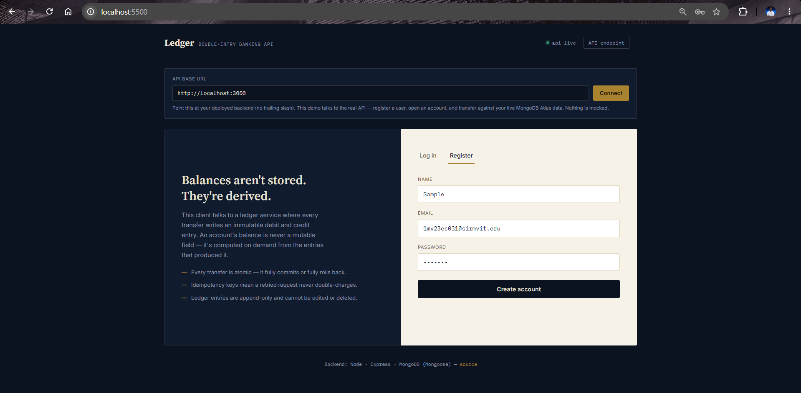
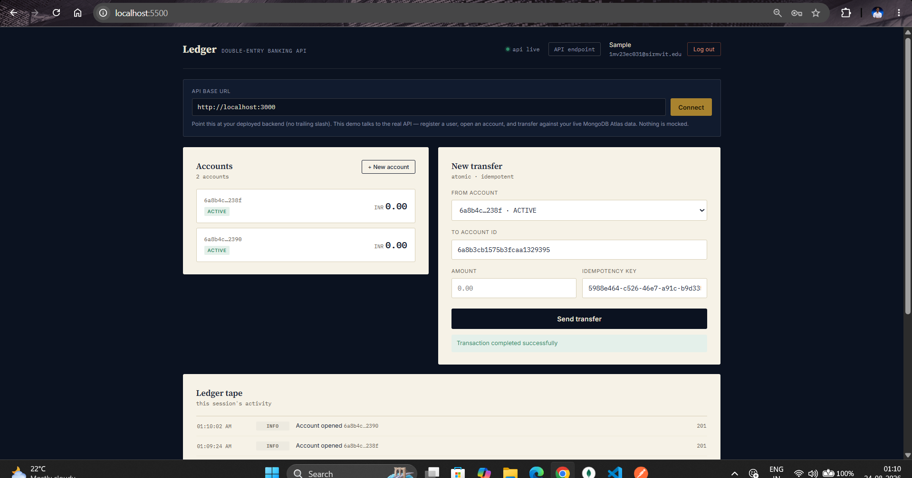
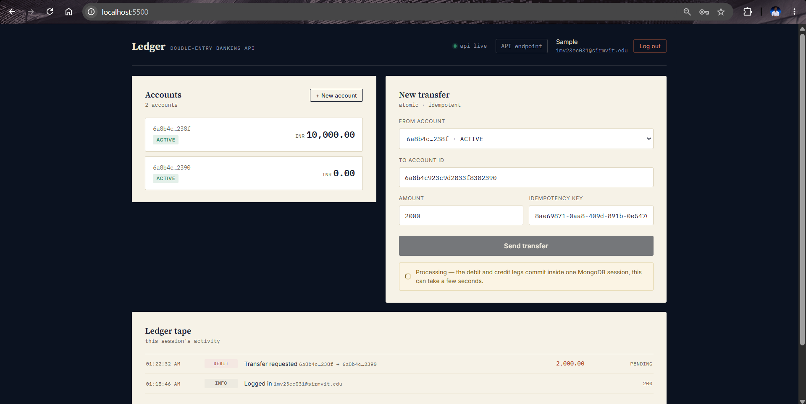
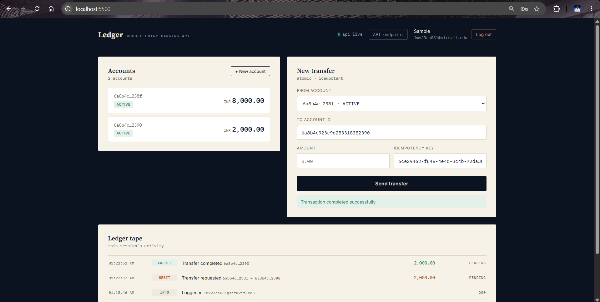
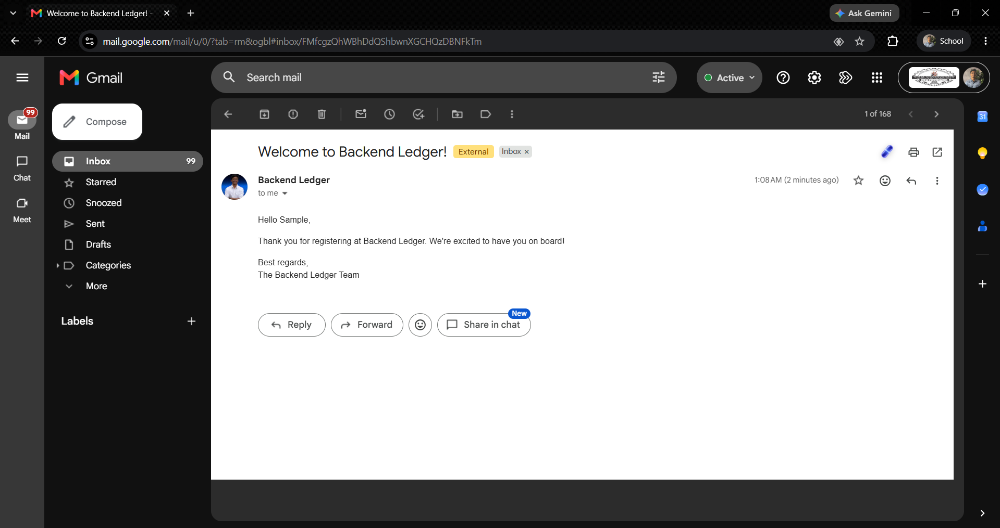

# Bank Transaction System – Backend


A backend service that models how real banking ledgers work: account balances are never stored as a single mutable number — they're **derived from an immutable, append-only ledger of credit/debit entries**, and money transfers are processed as atomic, idempotent, multi-step transactions.

Built with **Node.js, Express, and MongoDB (Mongoose)**, with a lightweight vanilla-JS frontend client for demoing the API live.

---

## 🔴 Live Demo

| | |
|---|---|
| **Frontend** | [bank-transaction-system-backend.vercel.app](https://bank-transaction-system-backend.vercel.app) |
| **Backend API** | [bank-transaction-system-backend-1.onrender.com](https://bank-transaction-system-backend-1.onrender.com) |

On first load, click **"API endpoint"** (top-right) and paste in the backend URL above, then click Connect — the frontend isn't hardcoded to a specific backend, so this is a one-time step per browser session.

> **Note:** the backend is hosted on Render's free tier, which spins down after 15 minutes of inactivity. The first request after a period of idle time can take 30–60 seconds to wake up — this is expected, not a bug. Subsequent requests are fast.

Register a user, open an account, and transfer funds against live MongoDB Atlas data — nothing on the live demo is mocked.

---

## Screenshots

| | |
|---|---|
|  |  |
| Login / Register screen | Dashboard — accounts, live balances, and the transfer form |
|  |  |
| Transfer in progress — atomic debit/credit commit | Ledger tape printing a completed transfer as a debit/credit pair |


Registration confirmation email, sent via Nodemailer + Gmail OAuth2

---

## Live demo client

A single-file HTML/JS client (`frontend/index.html`) is included to demo the API without needing Postman — register, open accounts, transfer funds, and watch a live "ledger tape" of debit/credit entries print as they happen. No build step, no framework.

**Running it locally instead:**
```bash
cd frontend
npx serve -l 5500
```
Open `http://localhost:5500`, click "API endpoint," and point it at your running backend (`http://localhost:3000` for local, or the deployed URL above). CORS is already enabled on the backend for this.

---

## Why this project

Most "wallet" demo apps just do `balance += amount` on a user document. That breaks under concurrent requests, retries, and crashes mid-transfer, and gives you no audit trail. This project implements the pattern real financial systems use instead:

- **Double-entry ledger** – every transaction creates a `DEBIT` entry on the sender's account and a `CREDIT` entry on the receiver's account. Account balance is computed on demand by aggregating these entries, never stored/overwritten.
- **Immutable ledger entries** – ledger documents block `update`/`delete` at the schema level (Mongoose pre-hooks), so historical entries can never be tampered with.
- **Idempotency keys** – every transfer request carries a unique key; replaying the same request (e.g. due to a network retry) returns the original result instead of double-charging the account.
- **Atomic transfers** – the debit, credit, and status update for a transaction run inside a single MongoDB session/transaction, so a transfer either fully succeeds or fully rolls back.
- **JWT auth with real logout** – tokens are blacklisted (with TTL auto-expiry) on logout, so logging out actually invalidates the token instead of just deleting it client-side.
- **Email notifications** – users get emailed on registration and on successful transactions (Nodemailer + Gmail OAuth2).

---

## Tech Stack

| Layer | Tech |
|---|---|
| Runtime |  |
| Framework |  |
| Database |   |
| Auth |  `bcryptjs` `httpOnly cookies` |
| Email |  (Gmail OAuth2) |
| Frontend (demo client) | Vanilla HTML / CSS / JS — no framework, no build step |
| Hosting | Render (API) · Vercel (frontend) |
| Other | `dotenv` `cookie-parser` `cors` |

---

## Architecture

```
frontend/index.html (Vercel)
  │
  ▼
Express App — src/app.js (Render)  ── CORS-enabled
  │
  ├── /api/auth          → register / login / logout (JWT issued, blacklisted on logout)
  ├── /api/accounts       → create account, list accounts, get derived balance
  └── /api/transactions   → create transfer, seed system "initial funds"
            │
            ▼
   ┌─────────────────────────────┐
   │   Transaction (PENDING)     │
   │   ↓                         │
   │   Ledger: DEBIT  (sender)   │  ── all inside one Mongo session/transaction
   │   Ledger: CREDIT (receiver) │
   │   ↓                         │
   │   Transaction → COMPLETED   │
   └─────────────────────────────┘
            │
            ▼
   Account balance = Σ(CREDIT) − Σ(DEBIT)   (computed on read, never stored)
            │
            ▼
      MongoDB Atlas
```

---

## Data Models

- **User** – email, hashed password (bcrypt), name, `systemUser` flag (used to seed initial funds into the system).
- **Account** – belongs to a user, has a `status` (`ACTIVE` / `FROZEN` / `CLOSED`) and `currency`. Exposes `getBalance()`, which aggregates the ledger.
- **Transaction** – represents a transfer attempt: `fromAccount`, `toAccount`, `amount`, `status` (`PENDING` / `COMPLETED` / `FAILED` / `REVERSED`), and a unique `idempotencyKey`.
- **Ledger** – immutable entries (`CREDIT` / `DEBIT`) linked to an account and a transaction. This is the actual source of truth for money movement.
- **TokenBlacklist** – stores logged-out JWTs with a TTL index so they auto-expire after 3 days.

---

## API Endpoints

Base URL (deployed): `https://bank-transaction-system-backend-1.onrender.com`

### Auth
| Method | Endpoint | Description |
|---|---|---|
| POST | `/api/auth/register` | Register a new user, returns JWT (sent as cookie + response body) |
| POST | `/api/auth/login` | Login, returns JWT |
| POST | `/api/auth/logout` | Blacklists the current token |

### Accounts (auth required)
| Method | Endpoint | Description |
|---|---|---|
| POST | `/api/accounts` | Create a new account for the logged-in user |
| GET | `/api/accounts` | List all accounts for the logged-in user |
| GET | `/api/accounts/balance/:accountId` | Get the live, ledger-derived balance for an account |

### Transactions (auth required)
| Method | Endpoint | Description |
|---|---|---|
| POST | `/api/transactions` | Transfer funds between two accounts (idempotent, atomic) |
| POST | `/api/transactions/system/initial-funds` | System-only: seed funds into an account |

#### Example: Create a transfer
```http
POST /api/transactions
Authorization: Bearer <token>
Content-Type: application/json

{
  "fromAccount": "65f1...",
  "toAccount": "65f2...",
  "amount": 500,
  "idempotencyKey": "a3f9c1e2-unique-per-request"
}
```

Response:
```json
{
  "message": "Transaction completed successfully",
  "transaction": {
    "_id": "...",
    "fromAccount": "65f1...",
    "toAccount": "65f2...",
    "amount": 500,
    "status": "COMPLETED",
    "idempotencyKey": "a3f9c1e2-unique-per-request"
  }
}
```

If the same `idempotencyKey` is sent again, the API returns the original transaction instead of creating a duplicate transfer.

---

## Running it locally

### Prerequisites
- Node.js (v18+)
- A MongoDB instance (local or Atlas)
- Gmail account with OAuth2 credentials (for email notifications) — optional, app runs without it failing requests

### Backend setup
```bash
git clone https://github.com/thakur-027/bank-transaction-system-backend.git
cd bank-transaction-system-backend
npm install
```

Create a `.env` file in the root:
```env
MONGO_URI=your_mongodb_connection_string
JWT_SECRET=your_jwt_secret
EMAIL_USER=your_gmail_address
CLIENT_ID=your_oauth_client_id
CLIENT_SECRET=your_oauth_client_secret
REFRESH_TOKEN=your_oauth_refresh_token
```

Run the server:
```bash
npm run dev     # with nodemon
# or
npm start
```

Server runs on `http://localhost:3000`.

### Frontend setup
```bash
cd frontend
npx serve -l 5500
```
Open `http://localhost:5500` and connect it to your backend's URL via the "API endpoint" field in the top-right.

---

## Deployment

- **Backend** is deployed on [Render](https://render.com) as a Node web service (`npm install` build command, `node server.js` start command), with environment variables set directly in the Render dashboard. MongoDB Atlas has its Network Access set to allow connections from anywhere (`0.0.0.0/0`) since Render doesn't use a static IP.
- **Frontend** is deployed on [Vercel](https://vercel.com) as a static site, with Root Directory set to `frontend` (it's a single `index.html`, no build step needed).

---

## Possible Next Steps
- Add transaction reversal endpoint (the `REVERSED` status is modeled but not yet wired up)
- Add rate limiting on auth/transaction routes
- Add automated tests (unit tests for balance aggregation, integration tests for the transfer flow)
- Add pagination/filtering for transaction history per account
- Add a `GET /api/transactions` endpoint for full account history (currently the frontend's ledger tape only reflects the current session's activity)
- Hardcode/default the deployed backend URL in the frontend so first-time visitors don't need to manually enter it

---